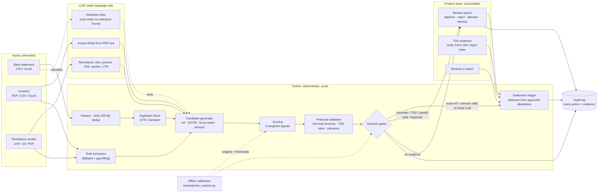

# ReconcileAI architecture

How the prototype divides work between the language model, deterministic code and people. It also covers how each decision can be traced, and where the design is weakest.

## Where AI, code and humans act

## Design decisions

**Exact versus probabilistic.**
- **Probabilistic:** reading free text. This means invoice PDFs, remittance emails and bank narrations.
- **Exact:** every amount, comparison, tax rate and balance. These use Python `Decimal` and fixed rules (`validation/financial_rules.py`, `validation/settlement.py`).
- **Where they meet:** the only bridge between the two is the candidate generator. LLM output becomes *candidate signals* that are verified against the ledger. A model-extracted invoice number that doesn't exist matches nothing. A model-extracted amount is never posted; the bank credit is.

**Why not one LLM call ("match these payments to these invoices")?**
- It can't be audited: there's no stable reason for the choice.
- It can't be reproduced, so the same input could get a different posting tomorrow.
- It is unsafe with money, because a fluent wrong answer looks the same as a right one.

**Why not rules only?**
- Rules alone cover clean references and exact amounts, which is about 44 % of credits in the test split.
- The remainder is language: "we have remitted ₹1,04,400 after TDS u/s 194C against bills 412 and 413", or a narration truncated to "ORBIT LOGISTI-AGAINST BILL 0045".
- The design uses the LLM only for that remainder, and always backs it with a regex extractor. So the system degrades gracefully with no API key, or when the model fails.

**Where knowledge lives.**

| Knowledge | Lives in | When it goes stale |
|---|---|---|
| TDS section rates, tolerance, duplicate window | `config/thresholds.py` (code, versioned) | A rate change needs a config change + redeploy. Nothing retrieves it automatically. |
| How much each signal is worth, and when to auto-match | `config/learned_params.json` (data, versioned) | Retrain on new labelled data (`training/train_matcher.py`). The baseline stays available via `RECONCILE_USE_LEARNED_PARAMS=0`. |
| Which invoice a vague payment belongs to | The reviewer | Rejections are remembered per credit, so the engine never re-proposes a rejected invoice. |
| Language patterns of narrations and emails | The LLM + regex | New bank formats show up as review-queue volume, not as wrong postings. |

**Traceability.** Every decision can be traced back:
- **Allocations:** each has a deterministic explanation built only from evidence ("invoice reference INV-001 appears in the bank narration; ₹1,18,000 equals the outstanding…"), a confidence score, and settlement components (bank credit + TDS + section + status).
- **Audit log:** every import, model extraction (raw output stored in `extractions`), automatic decision and human action is written there with its actor.
- **Balances:** invoice balances are recomputed from approved allocations, never edited, so any balance can be rebuilt from the allocation history.

**Human in the loop where the law needs one.** TDS is a tax matter, and a deduction is only creditable with the deductor's certificate (Form 16A, cross-checked against 26AS). So the system never treats TDS as settled on its own. It records the claim as *claimed* or *evidence pending*, routes the payment to review, and only a person can mark it *verified* (optionally attaching the certificate) or *reject* it, which re-opens the invoice for the deducted amount. The reviewer's name is recorded on every decision. The tool proposes; the finance team posts.

## Calibrating the matcher

Weights and thresholds were fit on 11.6k labelled synthetic credits. The objective is a business cost, not accuracy: a wrong auto-post costs 10× an avoidable review. The learned policy is easy to state: auto-post only with an exact invoice reference *and* an amount that validates, and only when no rival candidate scores close. A name + amount match always goes to a person. A test (`test_trainer_replay_agrees_with_engine`) checks that the trainer's vectorised replay makes the same decision as the real engine.

## Weakest points

1. **Synthetic evaluation.** The labels encode one team's policy, and the generator encodes my guesses about bank narration formats. Real statements would surely contain layouts the parser misses. Those would show up as review volume rather than wrong postings, but auto-match rates could drop sharply.
2. **Fuzzy customer identity.** A payer truncated to its first word ("APEX") can match the wrong group company. The guard is that a name never auto-posts on its own, but a wrong *suggestion* in review relies on the reviewer noticing.
3. **Remittance linking by amount.** An email without a UTR is linked to a credit only when exactly one remittance has that amount within ±10 days. Two customers paying the same amount on the same day makes it unlinkable (safe), not mislinked.
4. **Single-node SQLite, no auth.** This is fine for a prototype, but a multi-user deployment needs a server database, user identity and role separation (preparer ≠ approver).

## Considered and rejected

- **Letting the LLM decide matches.** Rejected for the auditability and reproducibility reasons above.
- **Embedding similarity / retrieval over invoices.** The decisive signals (invoice number, amount, GSTIN) are exact tokens, where string and number matching beats vectors. Retrieval would add a stochastic step for no gain.
- **Proportional splitting of bulk payments by default.** The engine instead proposes full settlement of each invoice whose balances add up to the credit, and asks a human. Proportional splits leave every invoice part-paid, which is rarely the payer's intent.
- **Hand-tuned thresholds.** The original 0.80/0.50 thresholds auto-posted only 21 % of credits and left 264 evidence-backed credits (15 %) unmatched in the test split. The calibrated policy auto-posts 44 % with zero errors and leaves 9 unmatched.
